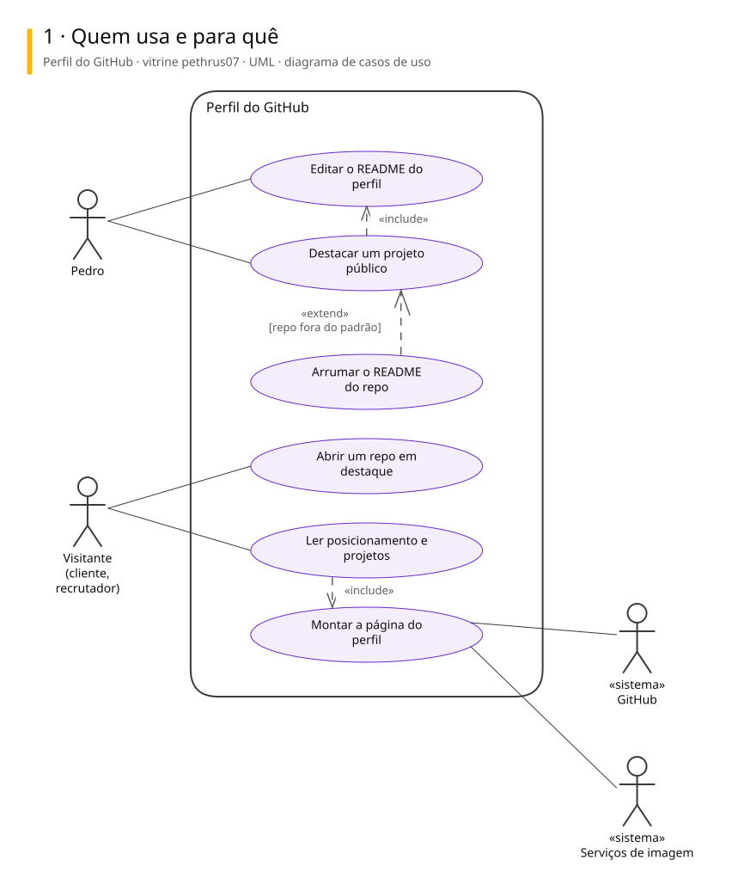
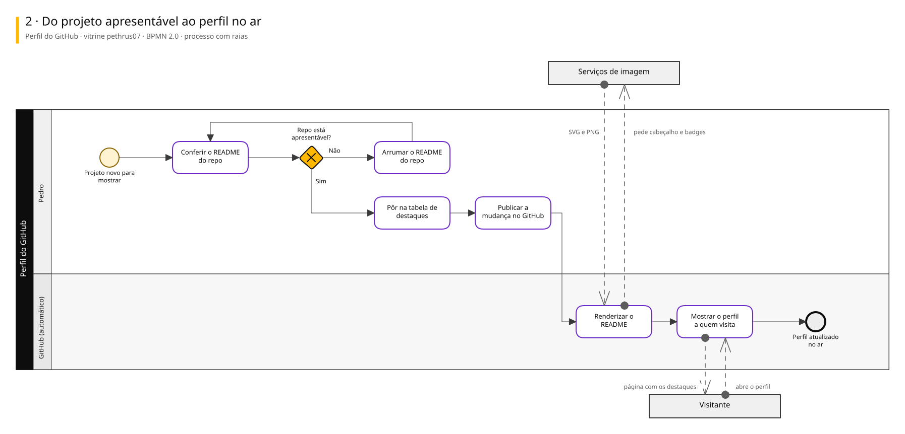
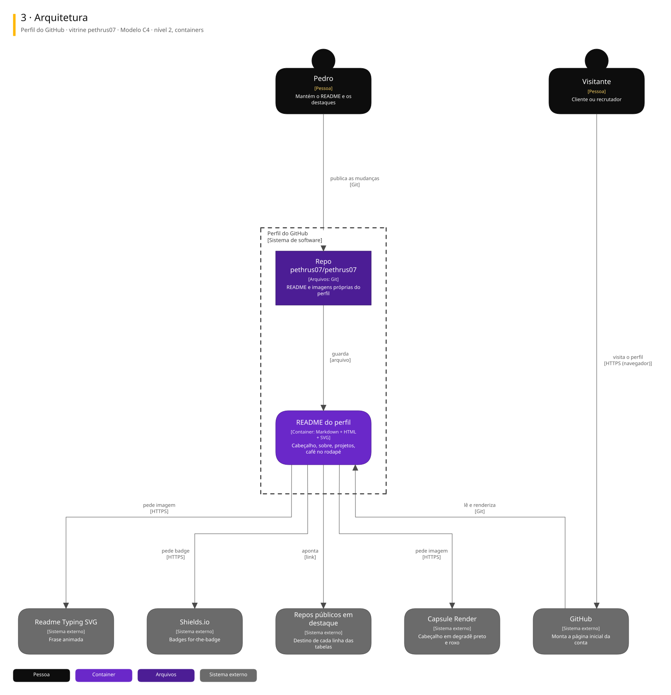

# Arquitetura

Três vistas do sistema, cada uma numa notação padrão.

| Vista | Notação | Responde |
|---|---|---|
| 1. Casos de uso | UML | Quem usa e para quê |
| 2. Processo | BPMN 2.0 | Como o trabalho anda, com uma raia para cada quem executa |
| 3. Arquitetura | C4, nível 2 | De que partes o sistema é feito e com quem conversa |

## Perfil do GitHub · vitrine pethrus07

Repositório especial pethrus07/pethrus07: o README aparece na página inicial da conta, em preto com roxo, e leva o visitante aos projetos públicos em destaque.

### 1. Quem usa e para quê

### 2. Do projeto apresentável ao perfil no ar

### 3. Arquitetura

Para editar: [perfil-do-github.excalidraw](./perfil-do-github.excalidraw), que abre em [excalidraw.com](https://excalidraw.com) ou na extensão Excalidraw do VS Code.

## De onde vêm

Os diagramas são gerados a partir do Sinapse, o vault onde o Pedro organiza notas e projetos. Mudança feita direto aqui some na próxima publicação: o lugar de mudar é a especificação no Sinapse.
